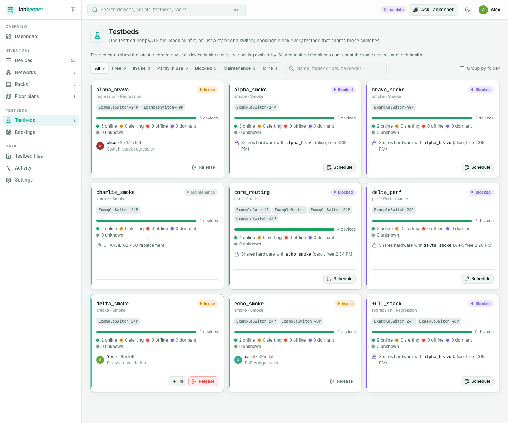

# Labkeeper

**Check your lab. Book the hardware. Keep the team in sync.**

Labkeeper brings device inventory, lab health checks, console checks, and equipment
booking into one application. See what a testbed contains, inspect its latest
status, and reserve the whole testbed—or only the devices you need.

It is an open-source starting point for **anyone building a lab management tool**.
Use your own inventory, locations, hardware, identity proxy, and monitoring
providers. The core works without a Meraki account, cloud subscription, or AI API
key. An optional Meraki adapter is included.

## Why use it?

- **Health and availability together.** Device health and booking availability are
  visible in the same workflow. An unbooked device and a healthy device are
  separate facts.
- **Conflicts follow the hardware.** Two differently named testbeds cannot reserve
  the same exclusive devices for overlapping times.
- **Book only what you need.** Reserve an entire testbed, a stack, or selected
  devices; leave the rest available to teammates.
- **Keep the inventory you already maintain.** Import pyATS-style YAML, including
  shared definitions, console routes, rack locations, and topology.
- **Check access before a test run.** Generic TCP checks and console probes help
  distinguish reachability, login prompts, busy lines, and usable prompts.
- **Make changes traceable.** Bookings, releases, status transitions, and inventory
  changes appear in an activity log.
- **Automate the same workflow.** Use the REST API or MCP tools from scripts and
  test jobs.

Health checks inform the operator; they do **not** automatically certify hardware
or prevent booking an unhealthy device.

*Fictional demo inventory: health, reservations, maintenance, and shared-device conflicts in one view.*

## Try the demo

The demo uses fictional inventory, simulated status, and local fake console
servers. It needs no lab access or API keys.

Requirements: Python 3.11+, [uv](https://docs.astral.sh/uv/), and Node.js 22.12+
(or a newer supported Node.js release).

~~~bash
git clone https://github.com/yuansshi/labkeeper.git
cd labkeeper

# Build the browser UI first.
cd frontend
npm ci
npm run build

# Start the application.
cd ../backend
uv sync
uv run labkeeper demo --host 127.0.0.1 --port 8000
~~~

Open [http://127.0.0.1:8000](http://127.0.0.1:8000). The demo includes existing
bookings and maintenance states so you can explore conflicts as well as free
testbeds. Its state is stored in a temporary demo directory; use a new
--data-dir path for a fresh demo.

### Docker

~~~bash
docker compose up --build
~~~

The supplied Compose configuration starts the demo and publishes it on localhost.
A named volume keeps application data. See [configuration](docs/CONFIGURATION.md)
to replace the demo with your own inventory.

## Connect your own lab

1. Copy [labkeeper.example.yaml](labkeeper.example.yaml) to labkeeper.yaml.
2. Create a testbeds folder and add your YAML definitions.
3. Set the testbed paths, health-check ports, booking policy, and locations for
   your environment.
4. From backend, run:

~~~bash
uv run labkeeper serve -c ../labkeeper.yaml
~~~

This minimal definition creates one bookable testbed. The addresses below are
documentation examples; replace them with your own endpoints.

~~~yaml
testbed:
  name: example_bench

devices:
  SWITCH_01:
    type: switch
    serial: LAB-SWITCH-001
    model: Example-24P
    connections:
      mgmt:
        protocol: ssh
        ip: 192.0.2.10
      console:
        protocol: telnet
        ip: 192.0.2.20
        port: 2001
    custom:
      labkeeper:
        provider: reachability
        network: Example lab
        location: ROOM_A_U12
~~~

The generic reachability provider needs no vendor API. A reachable TCP port is
evidence of reachability, not a full functional test. Console probes report what
answered and do not run a device acceptance test or recover a device.

## What is included?

| Area | Capabilities |
|---|---|
| Inventory | Devices, testbeds, shared hardware, stack members, networks, racks, topology |
| Lab checks | TCP reachability, console probes, status history, pluggable providers |
| Booking | Current and future reservations, partial device bookings, conflict checks, release and extend |
| Layout | Rack placement and editable floor plans, including a 3D view |
| Automation | REST API, MCP tools, activity log |
| Optional integrations | Meraki status adapter; additional providers and floor-plan sources through plugins |
| Optional AI | Assistant and image/PDF floor-plan interpretation, configured separately |

## Adapt it to your environment

Labkeeper is designed to be adapted, not tied to one organization's lab.

- Change your YAML inventory and grouping conventions without changing the UI.
- Add a status provider for your monitoring system, SNMP service, controller, or
  device API.
- Connect a floor-plan source to your DCIM or facilities system.
- Use the [booking API](docs/API.md) from existing CI or test automation.
- Customize the React frontend and Python service layer for your own workflow.

Start with [configuration](docs/CONFIGURATION.md),
[plugin development](docs/PLUGINS.md), and [architecture](docs/ARCHITECTURE.md).

### Optional Meraki adapter

The adapter is disabled by default. To use it, enable it in your configuration,
provide your own read-only API key on the server, and explicitly assign the
relevant devices to the meraki provider. No organization IDs, networks, device
serials, or credentials from an existing lab are included. See
[optional integrations](docs/CONFIGURATION.md#optional-meraki-adapter).

### Optional assistant

The core application and MCP tools work without an AI account. To enable the
assistant, install the AI extra, choose a supported model, and configure your own
credentials:

~~~bash
cd backend
uv sync --extra ai
export ANTHROPIC_API_KEY=...
export LABKEEPER_AGENT__ENABLED=true
export LABKEEPER_AGENT__MODEL=your-supported-model
uv run labkeeper serve -c ../labkeeper.yaml
~~~

Enabling an external AI service can send chat input and selected tool results to
that service. Review your lab's data policy before enabling it.

## Deployment and access

Labkeeper is an alpha application intended to run locally or behind an
authenticated reverse proxy on a trusted network. It does not include a built-in
SSO login or a hardened multi-tenant permission system. The user-name header is
attribution, not authentication.

Read [security and deployment](docs/SECURITY.md) before sharing a server. Keep
credentials, actual lab inventory, databases, uploads, and backups out of Git.

## Development

~~~bash
cd backend
uv sync --dev
uv run pytest -q

cd ../frontend
npm ci
npm run typecheck
npm run build
~~~

For separate frontend development, run the backend on port 8000 and npm run dev
in frontend. See [CONTRIBUTING.md](CONTRIBUTING.md).

## License

Labkeeper is distributed under **GNU GPL v3**. See [LICENSE](LICENSE).
Apache-licensed source notices retained from the original implementation are
listed in [NOTICE](NOTICE) and [LICENSES](LICENSES).
